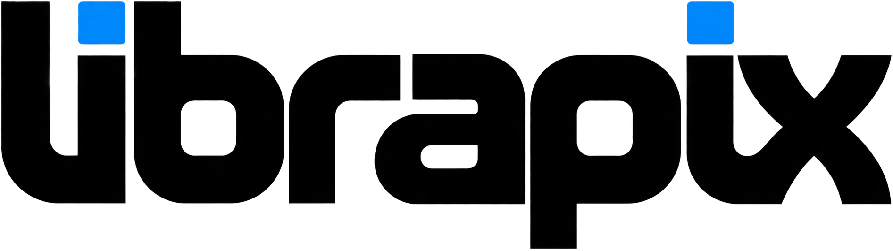
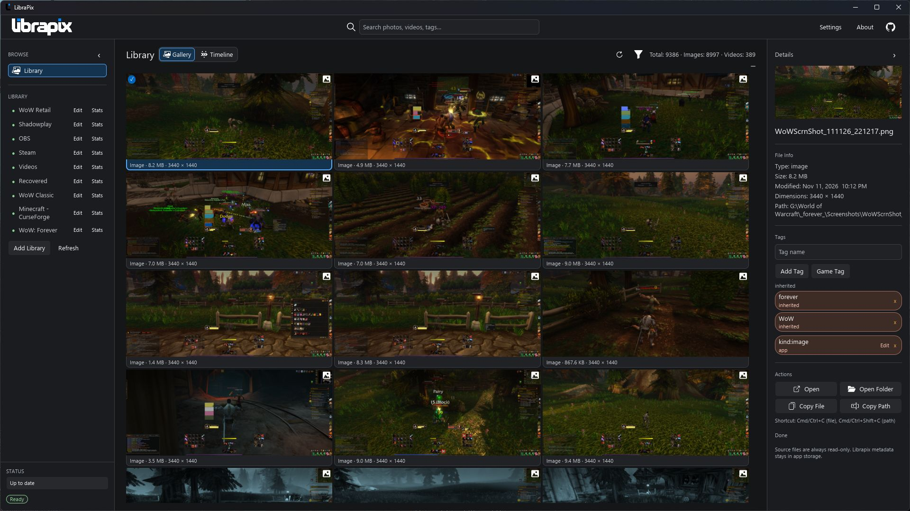

<h1 align="center">
  <picture>
    <source media="(prefers-color-scheme: dark)" srcset="assets/logo/index/librapix-wordmark-light.png">
    
  </picture>
</h1>

<p align="center">
  <b>Your screenshots and recordings. One local library.</b><br>
  Browse by gallery or timeline, find a moment, and make it yours to share.<br>
  Open source. Non-destructive. Built for the desktop.
</p>

<p align="center">
  
  
  
  <a href="https://github.com/asad-albadi/LibraPix/releases/latest"></a>
  <a href="LICENSE"></a>
</p>

<p align="center">
  <a href="https://github.com/asad-albadi/LibraPix/releases/latest"><b>Download LibraPix</b></a> &middot;
  <a href="#get-started">Get started</a> &middot;
  <a href="docs/README.md">Documentation</a> &middot;
  <a href="https://github.com/asad-albadi/LibraPix/issues">Report an issue</a>
</p>

<p align="center">
  
  <br>
  <sub>The Library in dark mode: local media, a selected screenshot, file details, tags, and sharing actions.</sub>
</p>

<p align="center">
  <a href="#features">Features</a> &middot;
  <a href="#get-started">Get started</a> &middot;
  <a href="#your-library-your-files">Your files</a> &middot;
  <a href="#make-short">Make Short</a> &middot;
  <a href="#development">Development</a> &middot;
  <a href="#status">Status</a> &middot;
  <a href="#license-and-credits">License</a>
</p>

## Features

<table>
  <tr>
    <td width="33%" valign="top">
      <h3>See the whole library</h3>
      Bring multiple local folders into one gallery. Switch to Timeline for date groups and a year scrubber. Collapse either sidebar when your media needs more room.
    </td>
    <td width="33%" valign="top">
      <h3>Find the right moment</h3>
      Search filenames and tags, filter by library, media type, extension, or tag, and inspect file details without leaving the app.
    </td>
    <td width="33%" valign="top">
      <h3>Share without rearranging</h3>
      Open a file or its folder, copy the file or its path, and turn a video into a vertical short. Original media stays untouched.
    </td>
  </tr>
</table>

- **One Library, two views:** Gallery and Timeline, with viewport-bounded rendering and background thumbnail generation.
- **Tags that stay in the app:** manual app/game tags and inherited library-level tags, with consistent colors and edit controls.
- **A library that keeps up:** filesystem watching, incremental indexing, cached startup snapshots, and new-file announcements.
- **Less noise:** centralized ignore rules, library lifecycle controls, and a minimum file size filter for indexing.
- **Your preferred appearance:** Light, Dark, or System, with persisted theme and independent pane-collapse preferences.
- **Background work:** indexing, thumbnails, release checks, and short generation run without putting that work on the rendering path.

## Get started

### Windows

Download `librapix-0.7.0-windows.exe` from [Releases](https://github.com/asad-albadi/LibraPix/releases/latest) and open it. This is the application executable, not an installer.

### Linux

Download `librapix-0.7.0-linux.AppImage` from [Releases](https://github.com/asad-albadi/LibraPix/releases/latest), make it executable, and run it from a graphical desktop:

```bash
chmod +x librapix-0.7.0-linux.AppImage
./librapix-0.7.0-linux.AppImage
```

Use the filename of the version you downloaded. Windows and Linux releases target x86-64. macOS packaging is currently disabled; no macOS download is provided.

### Video tools

Install **ffmpeg** and ensure it is on `PATH` for video thumbnails. **Make Short also requires ffprobe on `PATH`**. These tools are external prerequisites, not bundled with LibraPix. You do not need Rust to run a release download.

### Add your first library

1. Choose **Add Library**, browse to a folder, and optionally give it a display name and library-level tags.
2. Let LibraPix index the folder and generate thumbnails in the background.
3. Browse **Gallery** or **Timeline**, search or filter the results, and select a file to see its details and actions.
4. Use **Settings** to change appearance, manage ignore rules, and configure the default shorts output directory.

Add more roots at any time. Your folders remain where they are; adding a library does not import, move, or reorganize its files.

## Your library, your files

**Original media is read-only from LibraPix's perspective.** Tags, ignore rules, indexed metadata, and app state live in LibraPix-managed storage, not inside your screenshots or recordings.

| Stored by LibraPix | Purpose |
| --- | --- |
| `config.toml` | Preferences, pane layout, and configured path overrides |
| SQLite database | Library roots, indexed media, tags, ignore rules, statistics, catalog data, and snapshots |
| Thumbnail cache | App-owned image and video previews |
| Runtime logs | Startup and diagnostic information |

Indexing reads metadata without rewriting source files. Thumbnail generation writes to the app cache. Make Short creates a separate output file. See the [non-destructive guarantee](docs/architecture/non-destructive-guarantee.md) and [storage architecture](docs/architecture/storage.md) for the boundaries.

## Make Short

Select a video and choose **Make Short** in Details. Generate a vertical MP4 using the options supported by the original workflow:

- **Effects:** clean, enhanced, cinematic, night, scenic, and smooth.
- **Framing:** center, left, or right crop position.
- **Encoding:** playback speed, fade, CRF, and fast/medium/slow preset.
- **Output:** choose a file path; the default is your Videos directory under `LibraPix-Shorts`, named `<original-name>-short.mp4`. Change the default directory in Settings.

Hover explanations describe the choices. Smooth uses expensive interpolation and shows a visible warning. Generation runs in the background with an animated working state; **Cancel** stops the actual work and removes partial output. Success offers file/folder actions, while cancellation and failure have distinct states.

This is a focused short-generation workflow, not a video editor. It requires ffmpeg and ffprobe; see [Troubleshooting](docs/TROUBLESHOOTING.md) if generation fails.

## Development

### Build from source

Use Rust **1.85 or newer** with Cargo and support for Edition 2024. Platform build tools and a graphical desktop are required. Video features still require the external tools above.

```bash
git clone https://github.com/asad-albadi/LibraPix.git
cd LibraPix
cargo build --workspace
cargo run -p librapix-app
```

For an optimized application build:

```bash
cargo build --release -p librapix-app
```

### Checks

Run serially from the repository root:

```bash
cargo fmt --all
cargo check --workspace
cargo clippy --workspace --all-targets -- -D warnings
cargo test --workspace
```

<details>
<summary><b>Workspace and implementation</b></summary>

LibraPix is a native Rust application using **Iced**, not a web app. SQLite persistence uses `rusqlite`; configuration uses Serde/TOML; scanning and watching use `walkdir`, `globset`, and `notify`; fuzzy search uses `strsim`; thumbnails use `image`, `sha2`, and system ffmpeg. Native folder dialogs, OS file actions, theme detection, and Windows clipboard integration stay behind the app's orchestration boundaries.

| Crate | Responsibility |
| --- | --- |
| `librapix-app` | Iced state/messages/update, background orchestration, shared UI system, and product views |
| `librapix-core` | Shared app/domain state and message types |
| `librapix-config` | Configuration, validation, and platform paths |
| `librapix-storage` | SQLite persistence and migrations |
| `librapix-indexer` | Scanning and centralized ignore-rule evaluation |
| `librapix-search` | Search interfaces and fuzzy strategy |
| `librapix-projections` | Gallery/Timeline read projections |
| `librapix-thumbnails` | Deterministic thumbnail generation and caching |
| `librapix-video-tools` | Short validation, probing, filters, and ffmpeg orchestration |
| `librapix-i18n` | Keyed UI text and locale handling |

At startup, the app resolves config and storage, restores cached state, reconciles roots, updates the catalog/projections, and resolves thumbnails. Views render current state; user actions emit messages. Storage access, indexing, and ffmpeg process logic do not belong in widgets.

See [architecture overview](docs/architecture/overview.md), [message flow](docs/architecture/message-flow.md), [indexing](docs/architecture/indexing.md), and [dependencies](docs/DEPENDENCIES.md) for implementation details.

</details>

## Status

**Current release: 0.7.0.** This release delivers the centralized UI, persisted collapsible panes, refined dialogs and timeline rail, and INDEX branding. Windows executable and Linux AppImage builds are published through [GitHub Actions](.github/workflows/release.yml).

Current boundaries:

- Windows and Linux artifacts are available; successful builds do not establish compatibility with every distribution, graphics driver, or desktop environment.
- macOS release packaging remains disabled pending signing/notarization support.
- The shipped locale set is effectively `en-US`; localization is keyed for extension.
- Video processing requires external ffmpeg/ffprobe. The Smooth effect can take substantial time.
- Release update checks contact GitHub and require network access. Browsing the local library does not depend on those checks succeeding.
- Memories-style resurfacing is on the roadmap, not implemented in this release.

Read [Changelog](CHANGELOG.md) for delivered changes and [Troubleshooting](docs/TROUBLESHOOTING.md) for confirmed issues and resolutions.

## Documentation and contributing

- [Documentation index](docs/README.md)
- [Architecture overview](docs/architecture/overview.md)
- [Repository rules](docs/REPOSITORY_RULES.md)
- [Troubleshooting](docs/TROUBLESHOOTING.md)
- [MVP roadmap](docs/roadmap/mvp.md) and [future work](docs/roadmap/future.md)

Contributions are welcome. Read [AGENTS.md](AGENTS.md) and the repository rules, keep changes scoped and non-destructive, preserve crate boundaries, update documentation and the changelog, and run the checks above before opening a pull request. Report bugs and feature requests in [Issues](https://github.com/asad-albadi/LibraPix/issues).

## License and credits

LibraPix is licensed under the [MIT License](LICENSE). Created by Asad Al Badi. Dependencies retain their respective licenses; exact versions are recorded in [Cargo.lock](Cargo.lock).
